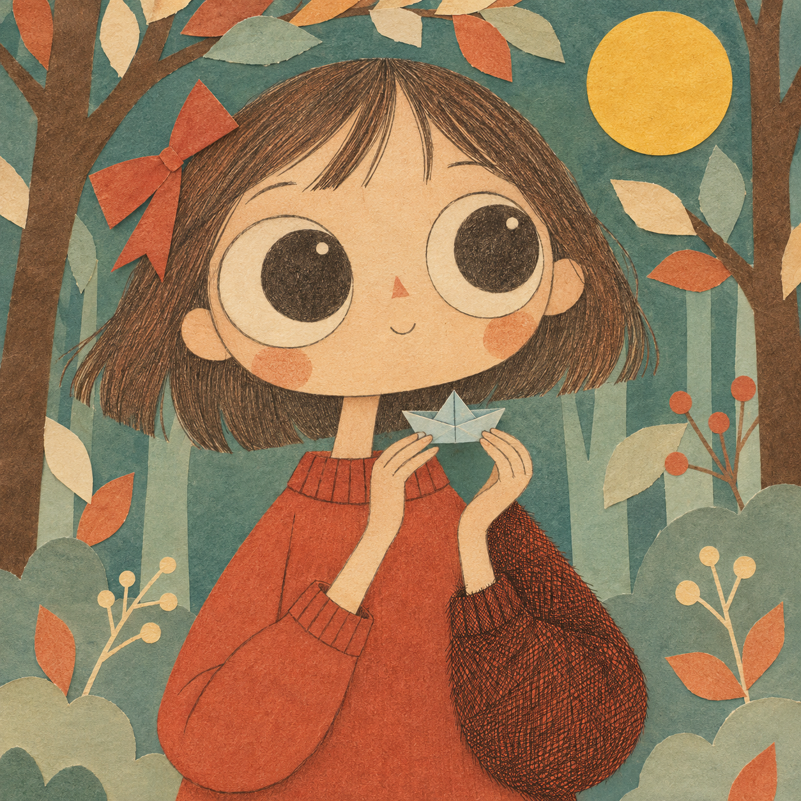
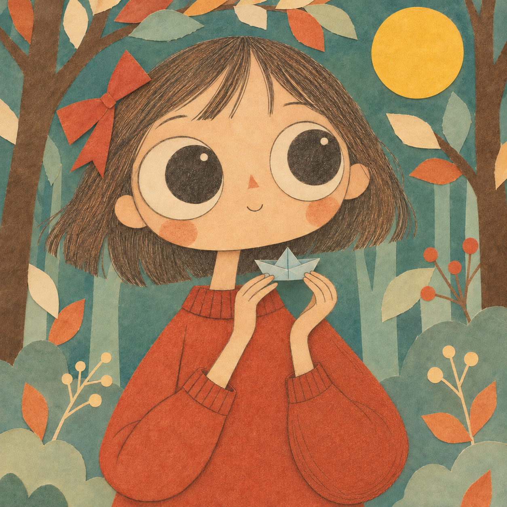
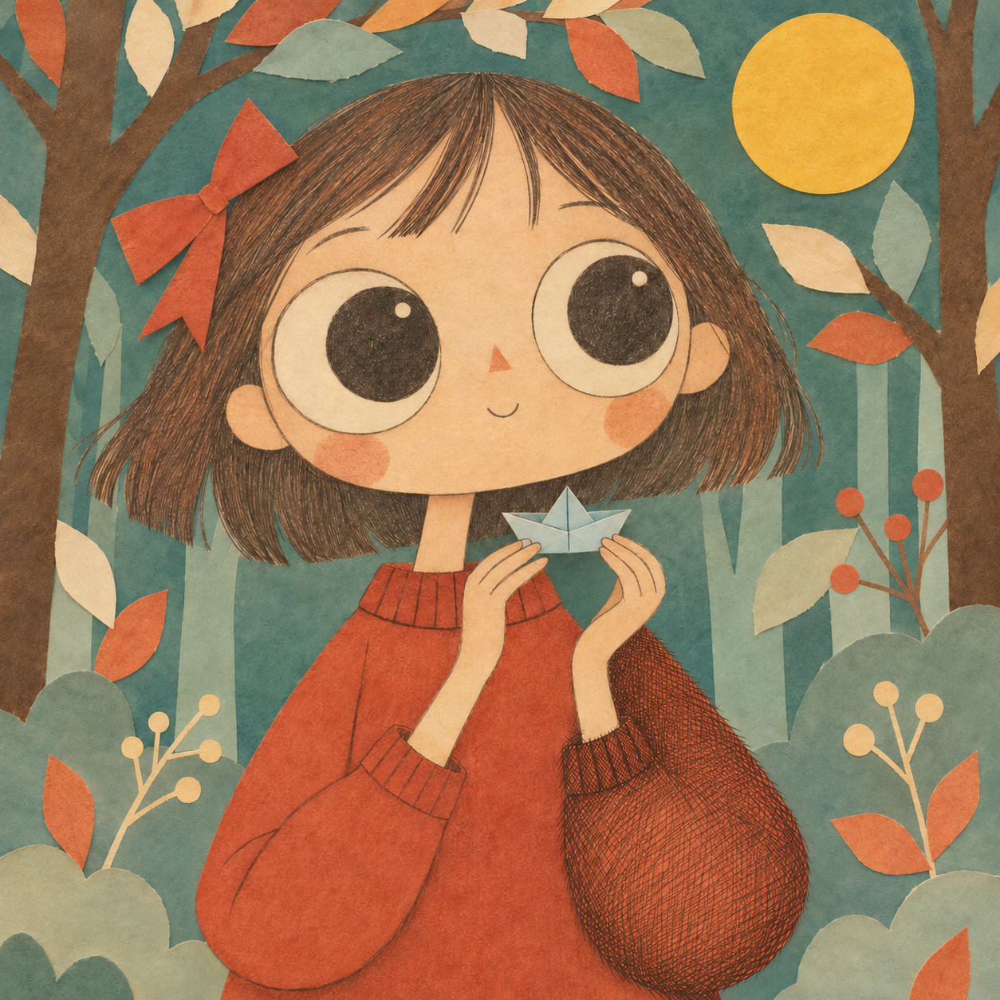
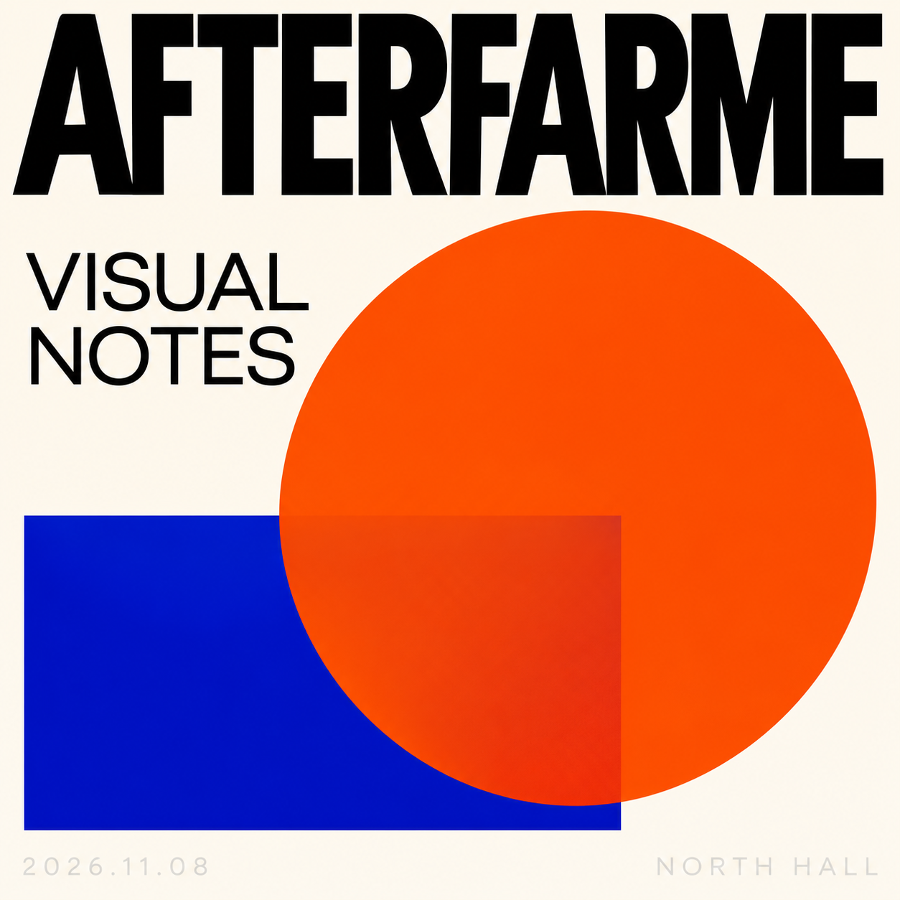
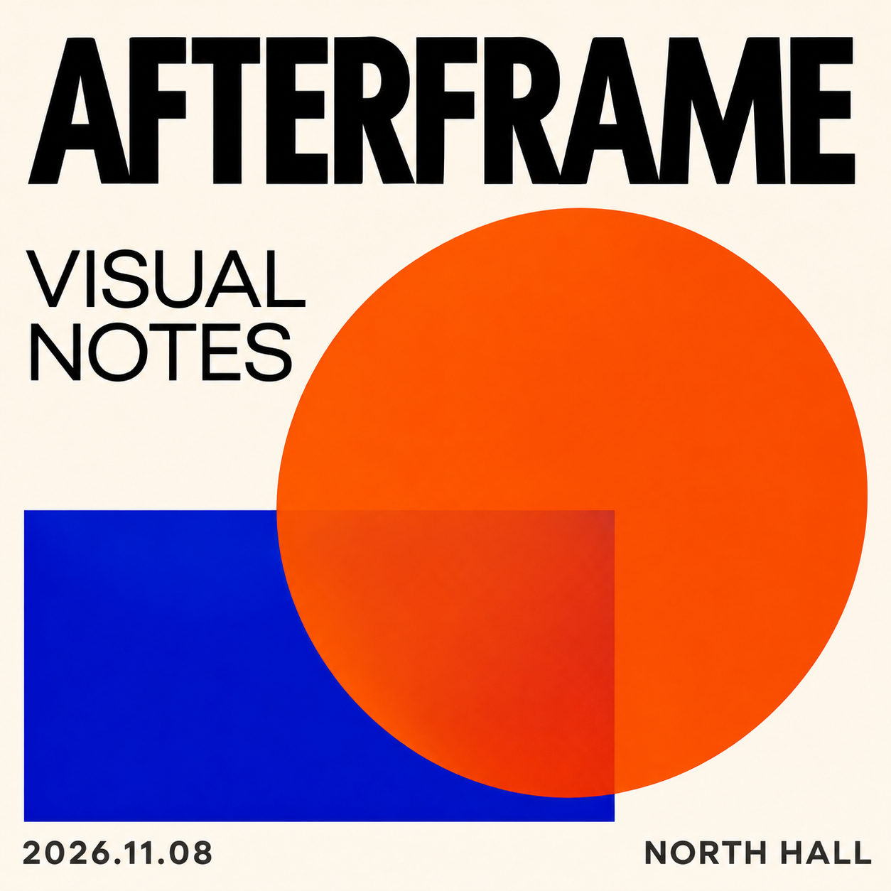
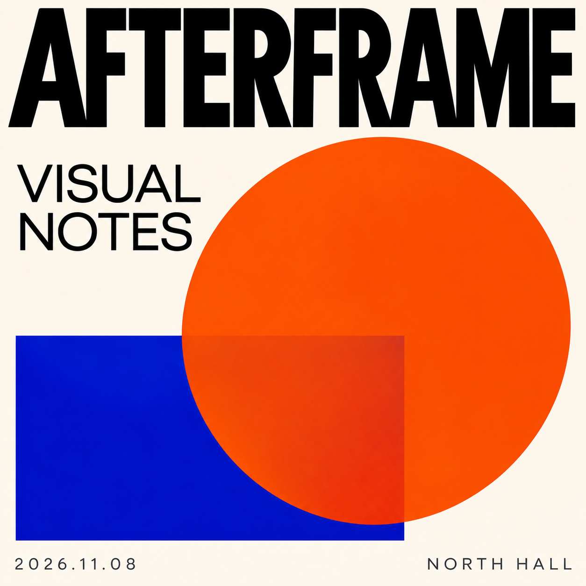

# 按各自诊断建议实际修整：原图与全部候选

本轮各组各生成一次，共六张候选。插画候选因全图纹理偏移未被采用，最终选择原图；它们仍在下面展示。机器人与海报选择 v1。

## 插画：右袖建议及普通组额外的手船轮廓建议

| 原图 | Without 候选 v1 | With 候选 v1 |
| --- | --- | --- |
|  |  |  |

## 像素视觉稿：硬边重建与条件性全图建议

| 原图 | Without 候选 v1 | With 候选 v1 |
| --- | --- | --- |
|  |  |  |

## 海报：两组各自的文字、对比度和排版建议

| 原图 | Without 候选 v1 | With 候选 v1 |
| --- | --- | --- |
|  |  |  |
